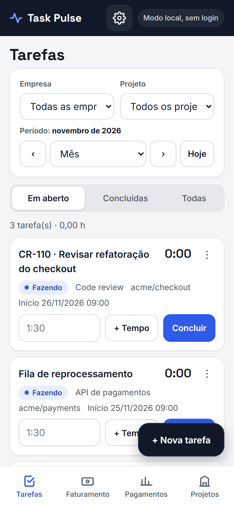
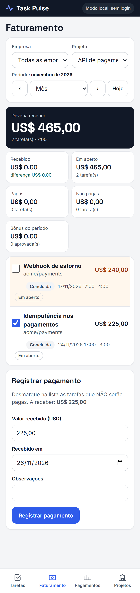
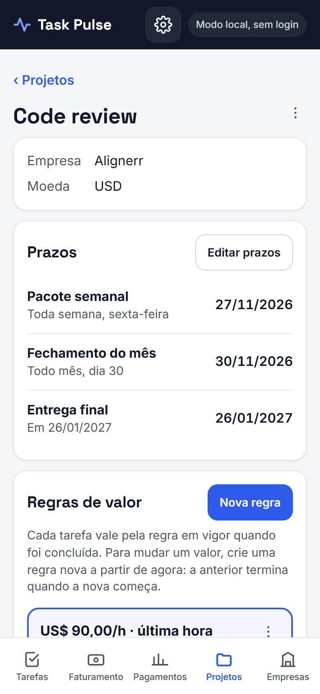
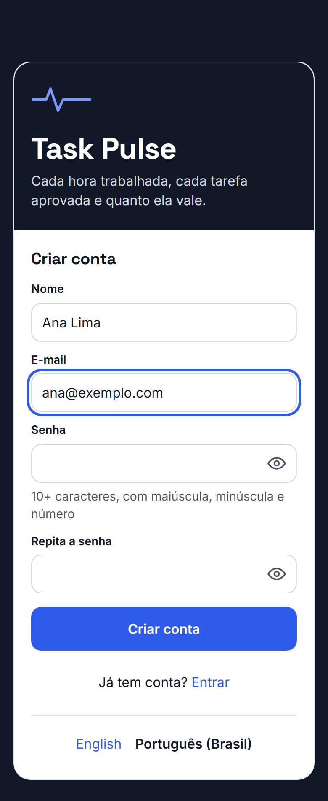
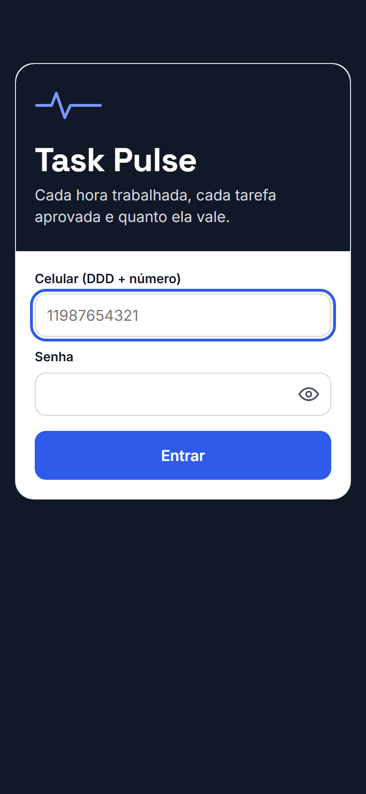
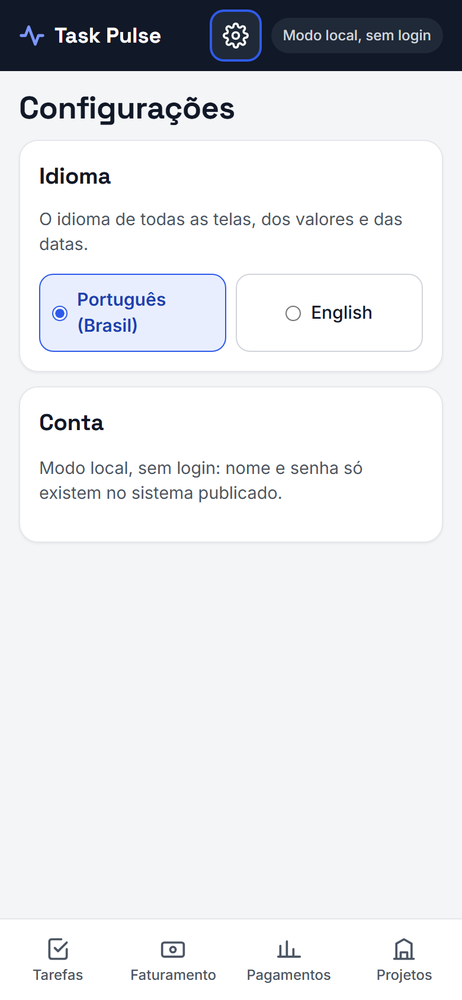
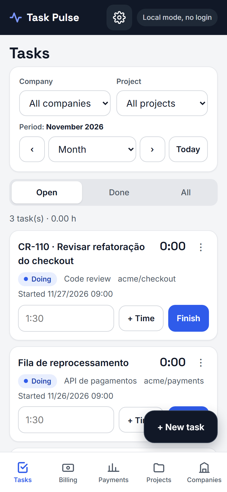
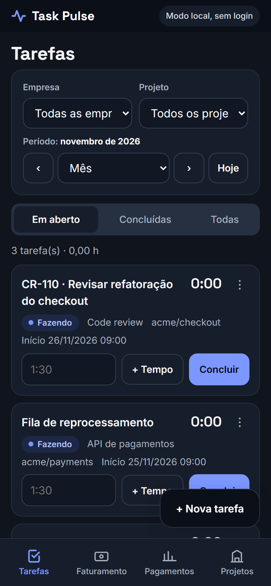
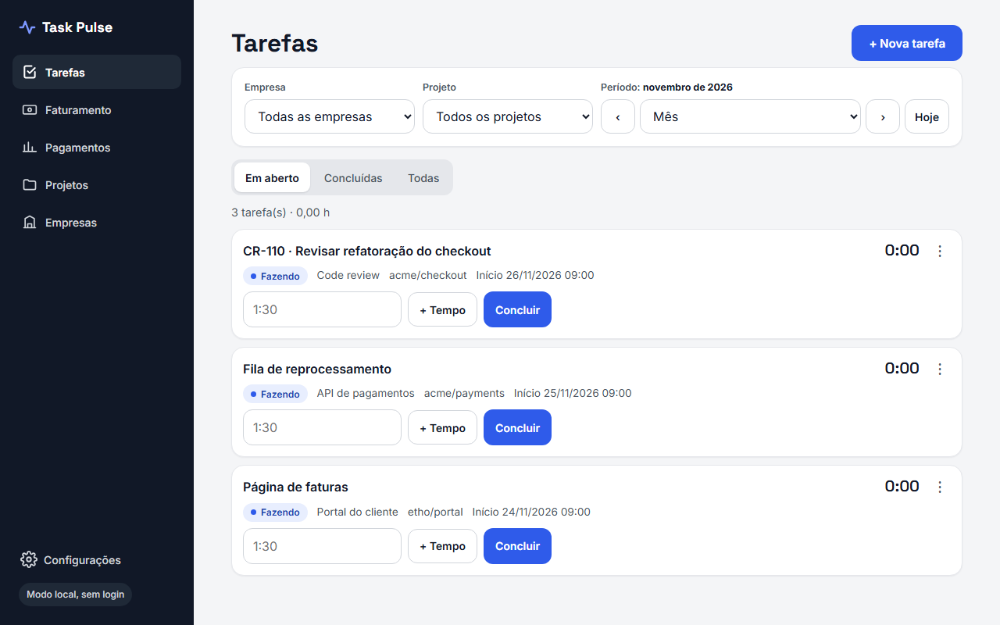
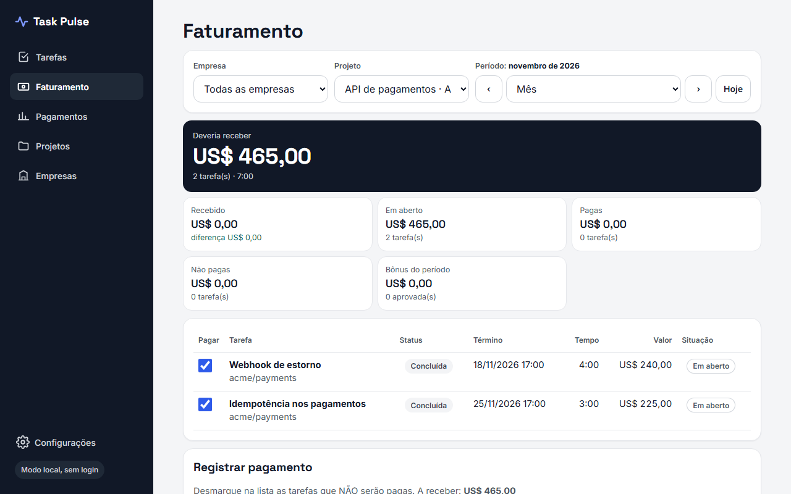

# Task Pulse

Tracks the work done for companies and what it is worth, serverless on AWS. Each **company** has
**projects**; each project has **pricing rules** (by the hour, with an optional flat last hour, or a
fixed amount per task; whether only approved tasks are paid; a bonus by approved tasks in the period),
each valid from a moment until another one starts. Each project has **tasks** (external id, name,
repository, description, start, time worked, finish). The **billing** page takes a company, a project
and a period, lists every task concluded in it with its value, lets you untick the ones that will
**not** be paid and register what was received; the app then shows what was paid, what wasn't, what
should have been received and what was received.

The app speaks **Portuguese (Brazil) and English**: each person chooses in *Configurações / Settings*. Code and docs are in English.

## What it looks like

Made for the phone first: one column, the menu at the bottom, every button big enough for a thumb.

| Tarefas | Faturamento | Projeto e regras | Criar conta |
|---|---|---|---|
|  |  |  |  |

<p>
  
  
  
  
</p>

Login by e-mail and password; *Configurações* (the gear, apart from the menu) with the language, the name and the password; the app in English; and the system's dark mode (above). From 1024px wide the menu becomes a sidebar and the
lists become tables:




These pictures come from the local server's demo data: `python dev.py screenshots` takes them again.

## Run it locally

Needs Python 3.12+ and Node 22.

```bash
python dev.py setup             # once: creates .venv/, installs TypeScript and downloads Chromium
python dev.py serve             # builds the frontend, then http://127.0.0.1:8765
python dev.py serve --empty     # start with nothing registered
```

No AWS, no login, no configuration. It opens with demo data ([local/seed.py](local/seed.py)): two
companies, three projects (hourly with a flat last hour and a bonus, hourly whose rate changed last
week, fixed per task) and their tasks, always dated around today. Data lives in memory and is gone
when you stop the server.

## Run the tests

```bash
python dev.py test    # backend tests + TypeScript type check (seconds)
python dev.py e2e     # builds the frontend, then the browser test in a real Chromium
python dev.py all     # both: what CI runs
python dev.py screenshots   # the pictures above, again (docs/screenshots)
```

| Tests | Where |
|---|---|
| Backend (pricing, rules by date, billing, API, DynamoDB format) | `local/tests/` (pytest) |
| Whole app in a browser | `local/e2e.py` (Playwright) |

## Architecture

```
Browser ──► CloudFront ──► S3                 the site (HTML/CSS + JS compiled from TypeScript)
   │
   └──► API Gateway ──► one Lambda per action ──► DynamoDB
        (checks the Cognito login)
```

```
frontend/   the site: TypeScript in src/, compiled to public/js   public/ deployed to S3
backend/    the Lambdas (Python)                                   deployed to AWS Lambda
infra/      Terraform for everything in AWS
local/      local server, in-memory database, tests                never deployed
dev.py      the commands above
```

### Frontend

TypeScript (`strict`), no framework and no bundler: `tsc` compiles each `src/*.ts` to an ES module in
`public/js/` (`npm run build`, which `python dev.py build|serve|e2e` and the deploy run). The compiled
files are not in git.

```
frontend/
  package.json, tsconfig.json   TypeScript, pinned; `npm run build | typecheck | watch`
  public/index.html, style.css  the page (public/js/ is the build output)
  src/app.ts            the menu (once logged in)
  src/screens/login.ts  Entrar, Criar conta, Confirmar e-mail (the code), first-access password
  src/api.ts            every call to the backend, typed
  src/auth.ts           Cognito login (tokens), sign-up, the login's name, language and password
  src/i18n.ts           the languages: t("texto") in Portuguese, its English in EN
  src/config.ts         where the API is (public/js/config.js is written by the deploy)
  src/types.ts          what the API answers
  src/util.ts           DOM helpers, money (cents), time (minutes), dates, dialogs
  src/screens/filters.ts   company / project / period (month or week) shared by every page
  src/screens/tasks.ts     Tarefas: open tasks by period, + Tempo, Concluir, Aprovar / Rejeitar
  src/screens/projects.ts  Empresas e projetos: companies, projects, pricing rules
  src/screens/billing.ts   Faturamento: a project's period, untick what won't be paid, register what was received
  src/screens/payments.ts  Pagamentos: every payment, should receive x received
  src/screens/settings.ts  Configurações (apart from the menu): language, name, password
```

The frontend doesn't know whether the backend is AWS or local: it calls `CONFIG.apiUrl`. The deploy
writes a `config.js` with the real API; the local server returns its own `config.js` pointing at itself,
with `skipLogin: true`.

### Backend

One Lambda per business action, hexagonal: each Lambda has its use case and its HTTP adapter;
everything else lives in a shared core, copied into every Lambda's zip.

```
backend/
  core/pulse_core/
    domain/models.py   Company, Project and its Rules, Task, Payment, and their validation
    domain/pricing.py  what a task is worth by its rule; the period's bonus
    ports.py           what use cases need: the Repository
    application.py     rules shared by several use cases (clock, lookups, the billing of a period)
    i18n.py            the API's error messages in English (Accept-Language: en)
    adapters/          DynamoDB, API Gateway input (login, ids, errors)
  lambdas/<action>/    list_companies, create_company, update_company, delete_company,
                       list_projects, get_project, create_project, update_project, delete_project,
                       create_rule, update_rule, delete_rule,
                       list_tasks, create_task, update_task, delete_task, add_task_time,
                       get_billing, create_payment, list_payments, delete_payment
    use_case.py        the action (only domain + ports, never AWS)
    handler.py         API Gateway event -> use case -> HTTP response
    lambda.json        {"route": "POST /projects", "database": "write"}
```

| Route | What it does |
|---|---|
| `GET /companies` · `POST /companies` · `PUT` · `DELETE /companies/{id}` | the companies (names unique ignoring case; one with projects can't be deleted) |
| `GET /projects?company_id=` · `GET /projects/{id}` | the projects, with their company, rules and the rule in force now |
| `POST /projects` · `PUT` · `DELETE /projects/{id}` | register (optionally with its first rule, `rule`), change, delete a project (with its tasks and payments) |
| `POST /projects/{id}/rules` · `PUT` · `DELETE /projects/{id}/rules/{rule_id}` | the pricing rules |
| `GET /tasks?company_id=&project_id=&from=&to=&state=` | `open` (default): DOING tasks started up to the end of the period; `finished`: concluded in it; `all` |
| `POST /projects/{id}/tasks` · `PUT` · `DELETE /projects/{id}/tasks/{task_id}` | add, change, delete a task |
| `POST /projects/{id}/tasks/{task_id}/time` | add time worked (`minutes`); with `finish`, conclude it now (or at `finished_at`) |
| `GET /projects/{id}/billing?from=&to=` | the period's tasks with their value and situation, the bonus and the totals |
| `POST /projects/{id}/payments` · `DELETE /projects/{id}/payments/{payment_id}` | register what was received for a period (`received_cents`, `not_paid_task_ids`); delete it |
| `GET /payments?company_id=&project_id=` | every payment: should receive, received, difference, not paid |

To add an action, create a folder with these three files. Terraform reads every `lambda.json` and
creates the function, the route and the logs. Lambdas marked `"read"` can only read the table.

Rules worth knowing:

- The user comes from the login token (`sub`), never from the request: each login sees only its data.
- Money is always integer cents, never a float; each project has its currency (BRL, USD, EUR). Time
  worked is whole minutes. A moment is `YYYY-MM-DDTHH:MM` in Brasília time.
- **Statuses**: `DOING` (started, no finish), `DONE` (concluded, waiting for approval), `APPROVED`,
  `REJECTED`. A task created already concluded needs its time and its finish. Concluding from the list
  takes this moment as the finish (or the one typed). Back to DOING, the finish is cleared.
- **Rules by date**: a rule is valid from `starts_at` until `ends_at` (excluded; empty = until another
  starts) and rules of a project never overlap. A task is priced by **the rule in force when it was
  finished**, so values can change in the middle of a day and a task finished before keeps the old
  value. Creating a rule closes the one still open at the moment the new one starts. Once a task
  (not yet billed) was concluded under a rule, its values can't change any more (only its end, and not
  to before that task): to change a value, create a new rule from now on.
- **Value of a task**: hourly, every minute at the hourly rate; with a flat rate, an **approved** task has
  its last hour (all of it, if under an hour) at the flat rate instead: 5h at 90 with a 100 flat =
  4 x 90 + 1 x 100 = 460. Fixed: the fixed amount per task, whatever the time. `REJECTED` is worth 0;
  with "só paga tarefa aprovada", `DONE` is worth 0 too until it is approved. Rounded to the cent, half up.
- **Bonus**: per billed period, by how many tasks were approved in it; the rule in force when the last of
  them was finished says the tiers, and the highest tier reached is paid (once: a later payment in the
  same period only takes what is still due).
- **Payments**: registering one closes the open tasks concluded in the period: each is `paid` or
  `not_paid` and its value is **frozen** in the payment, so a later rule change never changes what was
  billed. A billed task only changes its texts (name, id, repository, description) and can't be
  deleted; deleting the payment opens its tasks again. Should receive = paid tasks + bonus; the
  difference is received − should receive.
- An external id is unique per project (ignoring case); blank is allowed for any number of tasks.
- DynamoDB, single-table design: `PK = OWNER#<user>`, `SK = COMPANY#<id>`, `PROJECT#<id>` (rules
  inside, as a list), `TASK#<project id>#<id>`, `PAY#<project id>#<id>`. Every field is its own attribute
  in DynamoDB's types (`name` S, `minutes` and `*_cents` N, `paid_only_if_approved` BOOL, `time_log` and
  `rules` L of M), plus `entity` (COMPANY, PROJECT, TASK, PAYMENT); a field with no value is left out.
  A payment marks its tasks with `BatchWriteItem`, 25 items per call.

### Local

`local/server.py` serves `frontend/public/` and plays API Gateway: `local/api_gateway.py` reads the same
`lambda.json` files and calls the same Lambdas, with `local/memory_repository.py` instead of DynamoDB.
It only listens on 127.0.0.1.

## Deploy

Everything goes through GitHub Actions, with no terminal: a deploy runs every test (Python, TypeScript
and the browser test), then Terraform creates or updates all of AWS (Lambdas, API, Cognito, table,
site), then the site is built and published. Two environments, each in its own AWS account:

| Environment | Deploys when |
|---|---|
| `dev` (GitHub Environment `development`) | every merge into `main` (which only comes from `dev`) |
| `prod` (GitHub Environment `producao`) | no automatic trigger yet; only by hand: Actions → *Deploy production* → *Run workflow*, typing `producao` |

### Branches

```
feature branch (from dev) ──PR──► dev ──PR──► main ──► deploy dev
```

- Create each branch from `dev` and open its pull request into `dev`.
- `main` takes no direct pushes: only a pull request, and only from `dev`
  ([branch-flow.yml](.github/workflows/branch-flow.yml)), with CI green. A GitHub ruleset on `main`
  enforces it (Settings → Rules → Rulesets → *main*): no direct push, no force push, no deletion,
  pull request required, and the checks *Only dev into main*, *Backend (tests)*,
  *Frontend (TypeScript and browser)* and *Terraform (format and validation)* must pass. To create it:
  Settings → Rules → Rulesets → *New ruleset* → *Import a ruleset*, with
  [`docs/main-ruleset.json`](docs/main-ruleset.json). Merges into main are merge commits, so `dev`
  and `main` keep the same history.

```
merge into main ──► tests (CI) ──► terraform plan ──► check the plan ──► terraform apply ──► build + publish the site
```

The deploy **refuses a plan that would delete or recreate the Cognito user pool or the DynamoDB
table** (every login and all the data): that stops it before anything is applied.

### One-time setup

1. **In each AWS account:** create an IAM policy from [`docs/iam-deploy-policy.json`](docs/iam-deploy-policy.json)
   (it only touches `task-pulse-*` resources), a user without console access with that policy,
   and an access key for it.
2. **On GitHub** (Settings → Environments), create `development` and `producao`, each with:
   - secrets `AWS_ACCESS_KEY_ID` and `AWS_SECRET_ACCESS_KEY`
   - variables `AWS_ACCOUNT_ID` (the deploy stops if the key is from another account) and `AWS_REGION`
3. **First deploy:** merge a pull request from `dev` into `main`. The site's address shows up in the
   Actions run summary.
4. Recommended: *Deployment branches* = only `main` on both Environments, and *Required reviewers*
   (you approve each deploy) on `producao`.

### Languages

Every text is written in Portuguese in the code and translated where it is shown:
[frontend/src/i18n.ts](frontend/src/i18n.ts) has the English of each screen's text, and
[backend/core/pulse_core/i18n.py](backend/core/pulse_core/i18n.py) the English of each API error (the site
sends `Accept-Language`). Money, numbers and dates follow the language too (R$ 1.234,56 · 20/11/2026 or
R$1,234.56 · 11/20/2026). The first time, the app takes the browser's language; the choice is kept in the
browser and in the login (Cognito's `locale`), so it follows the person to another device. Tests fail if a
text has no English (`local/tests/test_frontend_i18n.py`, `local/tests/test_i18n.py`). To add a text, wrap
it in `t("...")` and add its English to `EN`.

### Logins

The login is the **e-mail and a password**. Anyone can create an account on the site (*Criar conta*:
name, e-mail, password with 10+ characters, upper and lower case and a number). Cognito e-mails a
6-digit code, and the account only logs in after the code is typed (*Reenviar código* sends another).
Each account sees only its own data. Cognito's own sender is used: no setup, but about 50 e-mails a
day; for more, configure SES in [infra/cognito.tf](infra/cognito.tf).

To create a login by hand: Actions → *Create user* → choose the environment, type the person's name and
e-mail. The workflow creates it with the e-mail already confirmed and a ready, permanent password, shown
in the run's summary (once; keep the repository private, since whoever can open the run sees it). For an
e-mail that already has a login, tick *reset_password* to give it a new password.

## Security and cost

- Encrypted table with continuous backups; deletion protection in `prod`.
- API Gateway rate-limits requests. The site may only talk to itself, Cognito and the API (CSP).
- Pay-per-use: close to zero with no traffic.
